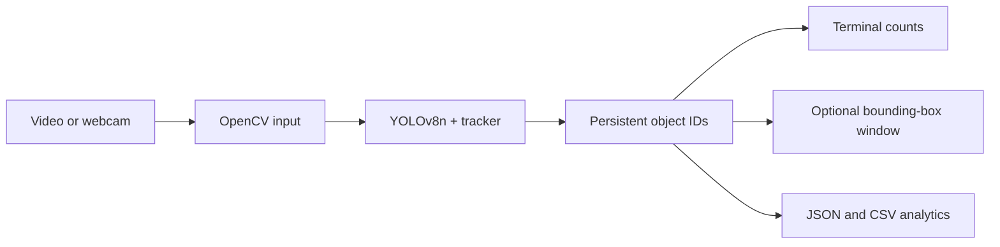

# Day 6 — Real-Time Object Tracking & Analytics Pipeline

A lightweight Python computer-vision pipeline that reads a video or webcam stream, runs Ultralytics YOLOv8 Nano, tracks objects across frames, prints counts to the terminal, displays optional bounding boxes, and exports compact JSON/CSV statistics without writing an annotated video.

> **Learning project:** YOLO detects object classes; the tracker maintains session-local IDs. A `person` detection is not face recognition or identity verification.

## What this demonstrates

- Frame-by-frame processing with `stream=True`.
- YOLOv8n object detection and tracking with `persist=True`.
- Bounding boxes, class labels, confidence scores, and track IDs.
- Optional OpenCV display with `q` to stop.
- Terminal counts for every processed frame.
- Compact JSON frame statistics and CSV per-track summaries.
- No heavy output video written to disk.
- API-free unit tests that do not download model weights.

## Architecture



Detailed design: [`docs/architecture.md`](docs/architecture.md).

## Windows setup

PowerShell:

```powershell
cd D:\Day6-real-time-object-tracking-analytics
py -m venv .venv
.\.venv\Scripts\python.exe -m pip install --upgrade pip
.\.venv\Scripts\python.exe -m pip install -r requirements.txt
```

The first real run may download `yolov8n.pt` from Ultralytics. You need internet access for that first download. A GPU is optional; CPU works but may be slower.

## Test without a video or model download

```powershell
.\.venv\Scripts\python.exe -m pytest -q
```

The tests validate source parsing, class filtering, and analytics aggregation. They do not download YOLO weights or open a camera.

## Run a local video

```powershell
.\.venv\Scripts\python.exe tracker.py --source "D:\Videos\traffic.mp4"
```

The default behavior:

- Uses `yolov8n.pt`.
- Opens an annotated OpenCV window.
- Prints frame-by-frame counts.
- Writes `tracking_stats.json`.
- Writes `track_summaries.csv`.
- Does not write an annotated video.

Press `q` in the OpenCV window to stop early.

## Run without a display window

Useful for a server, notebook, or headless environment:

```powershell
.\.venv\Scripts\python.exe tracker.py `
  --source "D:\Videos\traffic.mp4" `
  --no-display
```

## Use a webcam

The default webcam is usually device `0`:

```powershell
.\.venv\Scripts\python.exe tracker.py --source 0
```

Use `--no-display` only when you want terminal/statistics processing without a window.

## Track selected classes

Use class names supported by the YOLO model:

```powershell
.\.venv\Scripts\python.exe tracker.py `
  --source "D:\Videos\traffic.mp4" `
  --classes person car bus truck motorcycle
```

The script converts these names to model class IDs before tracking.

## Choose output paths

```powershell
.\.venv\Scripts\python.exe tracker.py `
  --source "D:\Videos\traffic.mp4" `
  --json-out "D:\Reports\traffic_stats.json" `
  --csv-out "D:\Reports\track_summaries.csv"
```

The JSON includes:

- Frames processed.
- Maximum objects in one frame.
- Total detections by class.
- Number of unique session-local track IDs.
- Per-frame counts.
- Per-track first/last frame, frames seen, maximum confidence, and last bounding box.

## Typical terminal output

```text
Frame 1 | car=3 person=1 | total=4
Frame 2 | car=3 person=1 | total=4
Frame 3 | car=4 person=1 | total=5
Completed 180 frames; unique track IDs=12
Wrote statistics: tracking_stats.json
Wrote track summaries: track_summaries.csv
```

## Model notes

`yolov8n.pt` means YOLO version 8 Nano. It is a small, fast model suitable for a learning demo, but it is less accurate than larger variants. Ultralytics may show a license notice on first use; review the model and library terms for your intended use.

## Limitations

- IDs can change after occlusion or difficult motion.
- A detection is not proof of identity.
- Accuracy depends on camera angle, lighting, resolution, motion blur, and object size.
- CPU processing may not be real-time for every video.
- The default tracker is not a permanent identity system.
- No automatic line-crossing or zone analytics is included yet.

## Next steps

Add line-crossing counts, region-of-interest alerts, FPS/latency metrics, tracker selection, a FastAPI endpoint, or a dashboard that reads the compact statistics.

## License

MIT for the project code. YOLO/Ultralytics model and library terms remain applicable.
