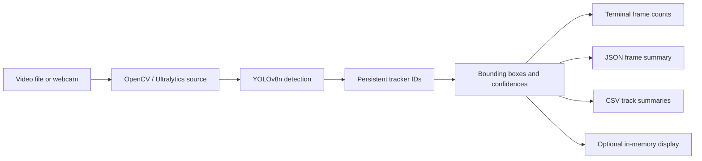

# Architecture

## Design decisions

- `model.track(..., stream=True, persist=True)` processes one result at a time instead of loading the complete video into memory.
- `result.plot()` is used only for an optional OpenCV display; no annotated video is written.
- JSON stores frame-level class counts and compact per-track summaries.
- CSV stores one row per track with first/last frame, frames seen, maximum confidence, and last bounding box.
- The model is loaded lazily when the tracking command runs, so unit tests do not download weights.

## Tracking caveat

Track IDs are session-local estimates. An object can receive a new ID after a long occlusion, scene cut, or difficult motion. A `person` label is not face recognition and does not identify a person.
